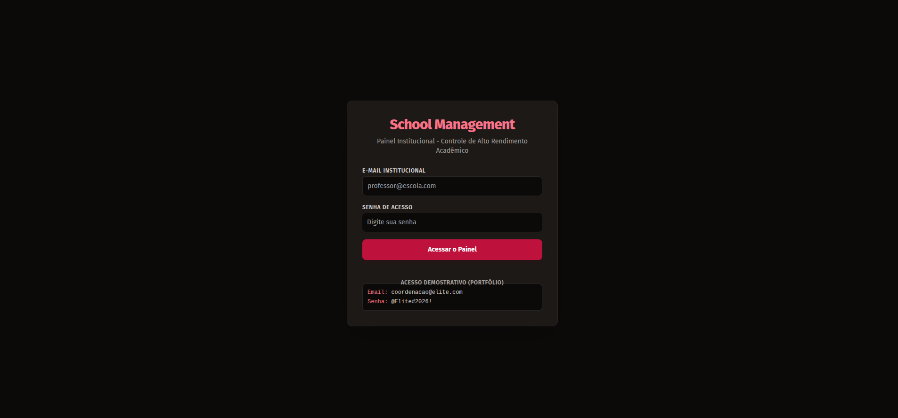
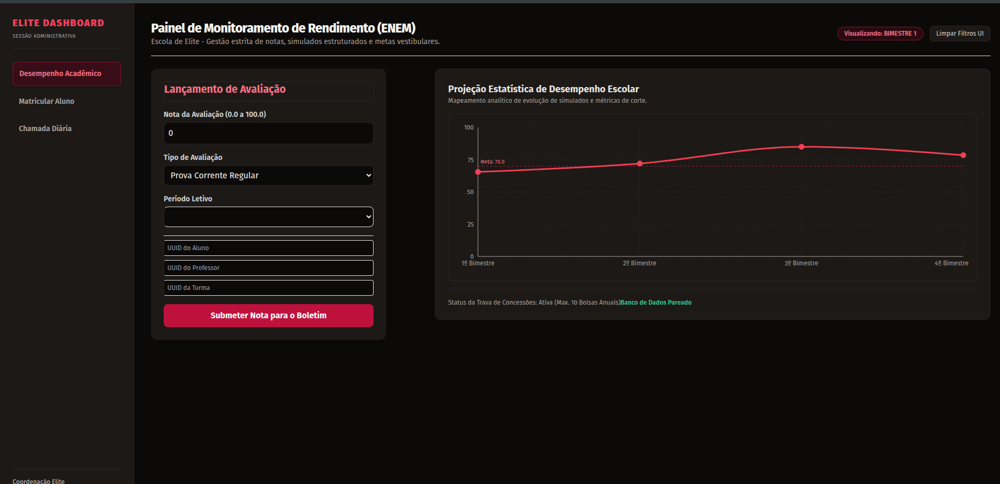
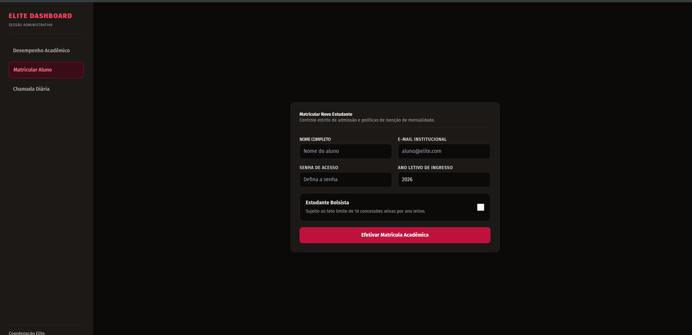
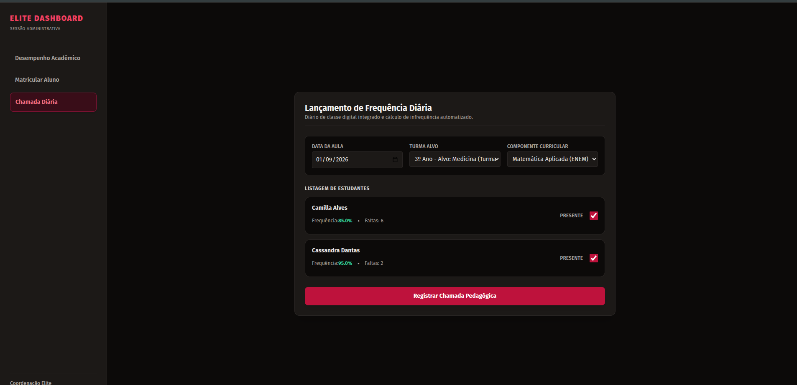

# 📊 School Management Dashboard - Escola de Elite


[](https://www.prisma.io/)
[](https://supabase.com/)


Um ecossistema Full-Stack de alta performance desenvolvido para gestão escolar pedagógica, governança administrativa e inteligência analítica de dados (Business Intelligence).

## 🔗 Demonstração em Tempo Real / Live Demo

👉 **Acesse o sistema no ar:** [School Management Dashboard](https://school-management-dashboard-woad.vercel.app)

- **E-mail de Acesso:** `coordenacao@elite.com`
- **Senha Corporativa:** `@Elite#2026!`

## 🚀 Como Executar o Projeto Localmente

Siga os passos abaixo para clonar e rodar o dashboard escolar em sua máquina de desenvolvimento:

1. **Clone o repositório:**

   ```bash
   git clone https://github.com
   cd school-management-dashboard
   ```

2. **Instale as dependências:**

   ```bash
   pnpm install
   ```

3. **Configure as Variáveis de Ambiente:**
   Crie um arquivo `.env` na raiz do projeto com base no arquivo `.env.example` e insira suas credenciais de conexão do banco de dados (Supabase/PostgreSQL) e do NextAuth.

4. **Sincronize e Popule o Banco de Dados:**
   Execute as migrações do Prisma e rode o script de semente (_seed_) para gerar os dados iniciais de estudantes e os perfis de teste da escola:

   ```bash
   npx prisma migrate dev
   npx prisma db seed
   ```

5. **Inicie o servidor de desenvolvimento:**

   ```bash
   pnpm dev
   ```

   Abra [http://localhost:3000](http://localhost:3000) no seu navegador para ver o resultado.

6. **Execução de Testes End-to-End:**
   - **Testes de Integração e Fluxo (Playwright):** `npx playwright test`

---

## 📸 Demonstração Visual / Visual Presentation

### 1. Autenticação e Segurança Corporativa / Corporate Authentication

Acesso restrito via NextAuth com sessões criptografadas e controle de credenciais baseado em papéis (RBAC).


### 2. Painel de Business Intelligence / BI Analytics Panel

Exibição gráfica temporal do rendimento acadêmico na paleta corporativa em tons de vinho (Recharts), com linha de corte fixa em 70.0 pontos.


### 3. Controle Rígido de Bolsas / Enrollment & Scholarship Control

Formulário reativo com animações nativas do Tailwind, integrado à API de transações para validação de isenções entre 10% e 100%.


### 4. Diário de Classe Unificado / Unified Class Journal

Cards e seletores parametrizados com os 12 componentes curriculares obrigatórios da BNCC e destaque visual para alunos com infrequência.


### 5. Ficha de Auditoria e Boletim por Bimestres (Vídeo) / Student Report Card

Navegação fluida pela Ficha Cadastral de Alta Performance exibindo máscaras de UUID, alocações e notas reais sincronizadas por Bimestres (1ºB, 2ºB, 3ºB, 4ºB) e Simulados ENEM.
<video src="https://github.com/user-attachments/assets/4d24f601-e272-47ac-9738-d34f4c3ef3cb" width="100%" controls muted></video>

---

## 🛠️ Tecnologias e Arquitetura do Ecossistema

- **Framework:** Next.js 14 (App Router)
- **ORM & Banco de Dados:** Prisma 7 + PostgreSQL hospedado na nuvem pelo Supabase
- **Estilização & Design:** Tailwind CSS + `tailwind-scrollbar` (Rolagem Customizada Minimalista)
- **Segurança & Validação:** NextAuth.js (Sessões Criptografadas JWT na borda) + Zod v4 Core

---

## 🛑 Regras de Negócio e Requisitos de Governança (BNCC)

### 1. Perfis de Acesso Estritos (RBAC)

- **Coordenação (`COORDINATOR`):** Permissões irrestritas de Leitura e Escrita (CRUD) em todo o ecossistema.
- **Professores (`TEACHER`):** Escopo restrito ao lançamento de notas e presenças de turmas vinculadas.
- **Alunos (`STUDENT`):** Visualização pura e isolada do próprio boletim técnico e histórico.

### 2. Módulo de Matrículas e Trava Financeira de Bolsas

- **Limite Anual Fixo:** O sistema possui uma trava de segurança que impede a concessão de mais de **10 bolsas de estudo ativas por ano letivo** via transação atômica (`$transaction`).
- **Consistência de Isenção:** O campo `isScholarshipPercentage` aceita valores entre 10% e 100% apenas se a flag de bolsa for ativa, sendo forçada a 0 automaticamente em casos regulares.

### 3. Módulo de Frequência e Idempotência Procedural

- **Limite de 75% de Presença:** Alunos com presença abaixo de 75% são destacados automaticamente com o status visual na cor vinho profundo (`Bordeaux/Rose`), alertando sobre o risco de reprovação.
- **Idempotência Blindada:** A API impede folhas de presença duplicadas para a mesma data/turma/matéria usando travas com cláusulas de `findFirst` e `create` procedurais, eliminando falhas de concorrência.

### 4. Sincronismo Automático e Matriz Curricular BNCC

- **Matriz Curricular Unificada:** Integração dos 12 componentes obrigatórios do Novo Ensino Médio divididos por áreas do conhecimento.
- **Alinhamento Cronológico de Médias:** As notas submetidas na tela de desempenho alimentam **automaticamente** e em tempo real as colunas do 1ºB, 2ºB, 3ºB e 4ºB da Ficha do Aluno, separando as avaliações regulares dos Simulados Modelo ENEM.

---

## 🧠 Desafios e Aprendizados

Desenvolver um ecossistema de governança escolar completo consolidou competências complexas de engenharia de software:

- **Segurança Multicamadas com RBAC:** Integrar autenticação JWT via NextAuth na borda com regras restritas de acesso no banco de dados mitigou brechas de privilégios de rotas entre alunos, professores e coordenação.
- **Prevenção de Condições de Corrida:** Implementar travas financeiras de bolsas de estudos exigiu o domínio de transações de isolamento atômico (`$transaction`) nativas do Prisma 7, garantindo a idempotência de dados concorrentes.
- **Sincronismo Analítico em Tempo Real:** Mapear os 12 componentes curriculares da BNCC e plotar gráficos temporais de desempenho usando Recharts demandou a otimização de queries relacionais com paginações eficientes para evitar gargalos de renderização.

---

# 📊 School Management Dashboard - English Version

A high-performance Full-Stack ecosystem built for pedagogical school management, administrative governance, and business intelligence (BI) data analytics.

## 🔗 Live Demo

👉 **Access the system online:** [School Management Dashboard](https://school-management-dashboard-woad.vercel.app)

- **Access Email:** `coordenacao@elite.com`
- **Corporate Password:** `@Elite#2026!`

## 🚀 How to Run Locally

Follow these steps to clone and execute the school dashboard system on your local developer environment:

1. **Clone the repository:**

   ```bash
   git clone https://github.com
   cd school-management-dashboard
   ```

2. **Install dependencies:**

   ```bash
   pnpm install
   ```

3. **Configure Environment Variables:**
   Establish a local `.env` profile at the root folder path modeled after `.env.example`, populating database connection uris (Supabase/PostgreSQL) and NextAuth security strings.

4. **Sync and Seed the Database:**
   Push Prisma schema migrations down to your environment and fire up the seed script to auto-generate initial mock students matrixes and core corporate credentials profiles:

   ```bash
   npx prisma migrate dev
   npx prisma db seed
   ```

5. **Run the development environment:**

   ```bash
   pnpm dev
   ```

   Open [http://localhost:3000](http://localhost:3000) inside your browser.

6. **Executing End-to-End Test Suites:**
   - **Automated E2E Flow Testing (Playwright):** `npx playwright test`

---

## 📸 Visual Presentation

### 1. Corporate Authentication & Security

Restricted access via NextAuth featuring encrypted sessions and role-based access control (RBAC).


### 2. BI Analytics Panel

Time-series visualization of academic performance using a corporate burgundy color palette (Recharts), featuring a static 70.0 cutting-edge threshold line.


### 3. Enrollment & Scholarship Control

Reactive form with native Tailwind animations, integrated with the transactions API for validation of fee exemptions between 10% and 100%.


### 4. Attendance Tracking & Risk Monitoring

Automated cards and selects parameterized with the 12 core Brazilian subjects (BNCC), with a visual alert for students under low attendance.


### 5. Interactive Student Report Card (Video Demo)

Smooth navigation through the High-Performance Student Sheet displaying UUID masks, allocations, bimonthly fields (1stB, 2ndB, 3rdB, 4thB), and standard ENEM mock exams.
<video src="https://github.com/user-attachments/assets/4d24f601-e272-47ac-9738-d34f4c3ef3cb" width="100%" controls muted></video>

---

## 🛠️ Tech Stack and Architecture

- **Framework:** Next.js 14 (App Router)
- **ORM & Database:** Prisma 7 + PostgreSQL hosted in the cloud via Supabase
- **Styling & Design:** Tailwind CSS + `tailwind-scrollbar` (Custom Minimalist Scrollbars)
- **Security & Validation:** NextAuth.js (Encrypted JWT Sessions on the Edge) + Zod v4 Core

---

## 🛑 Critical Business Rules and BNCC Requirements Implemented

### 1. Strict Access Profiles (RBAC)

- **Coordenação (`COORDINATOR`):** Unrestricted Read and Write (CRUD) permissions across the entire ecosystem.
- **Professores (`TEACHER`):** Scope restricted to submitting grades and attendance records for linked classrooms.
- **Alunos (`STUDENT`):** Pure read-only view isolated to their own technical report cards and academic history.

### 2. Enrollment Module and Financial Scholarship Lock

- **Fixed Annual Threshold:** The system strictly blocks the granting of more than **10 active scholarships per academic year** using database atomic transactions (`$transaction`).
- **Exemption Consistency:** The `isScholarshipPercentage` field accepts integer values between 10% and 100% only if the scholarship flag is active, defaulting to 0 automatically otherwise.

### 3. Attendance Module and Procedural Idempotency

- **75% Attendance Threshold:** Real-time runtime computation triggers a deep-wine visual highlight (`Bordeaux/Rose`) on cards for students whose attendance drops **below 75%** (At Risk status).
- **Shielded Idempotency:** The server-side API prevents duplicate attendance sheets for the same date/class/subject using procedural operational `findFirst` and `create` lookups to handle concurrency seamlessly.

### 4. Automated Grade Sync & BNCC Framework

- **Unified Academic Matrix:** Full integration of the 12 core subjects required by the Brazilian National Curriculum (BNCC) divided by structural knowledge fields.
- **Bimonthly Chronological Alignment:** Grades submitted on the performance screen **automatically** populate bimonthly fields (1stB, 2ndB, 3rdB, 4thB) and structural ENEM mock exam records in real-time.

---

## 🧠 Technical Challenges and Learnings

Building a robust educational governance environment solidified deep architectural software engineering principles:

- **Multi-Role RBAC Systems:** Intertwining encrypted edge JWT sessions using NextAuth alongside strict structural database constraints barred authorization leaks between students, faculty teachers, and institutional auditors.
- **Race Condition Mitigations:** Implementing atomic database transactions (`$transaction`) via Prisma 7 to enforce the strict 10-scholarship annual lock prevented structural operational discrepancies under concurrent requests.
- **Analytical Optimization Tuning:** Interfacing Recharts analytics pipelines with heavy multi-table relation structures (12 BNCC core elements maps) required optimal query filtering and decoupled states to guarantee fluid frame renders.
